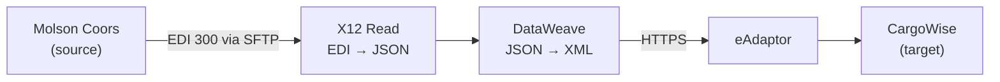

# MuleSoft Project Session Notes

Transcripts, slides and diagrams from one-to-one MuleSoft project mentoring sessions (spoken in Telugu, written up in English). They are for practising how to explain a real-time integration project in interviews.

## Part 1 — Molson Coors → CargoWise booking integration

- [Cleaned transcript](transcripts/part1.md): job-search plan, MuleSoft basics, a duplicate-transaction design question, the project walkthrough, a word-for-word interview script and the practice task
- [Slides and diagram](slides/part1/README.md): screens from the session, the integration flow diagram, and the sample EDI 300 file explained line by line
- Raw Whisper output: [part1-raw.txt](transcripts/part1-raw.txt) · [part1-raw-gaps-large-v3.txt](transcripts/part1-raw-gaps-large-v3.txt)

## How these were made

1. **Transcript:** Whisper (`medium`, run locally) translated the Telugu audio to English. Spans it skipped were re-run with `large-v3`.
2. **Slides:** ffmpeg scene detection extracted frames, near-duplicates were removed, and the meaningful screen-share frames were picked and cropped to the shared window.
3. **Cleanup:** Claude corrected misheard terms using the on-screen text, removed repetition loops, and added punctuation, speakers and screen markers. Nothing was invented; unrecoverable parts are marked **[unclear]**.
