# Project Session Part 1 — Super-Detailed Notes

**Molson Coors → CargoWise booking integration: how it works, how to explain it in an interview, and how to build it yourself.**

Source: the Part 1 mentoring session ([cleaned transcript](../transcripts/part1.md), [slides](../slides/part1/README.md)). Times in brackets like *(33:51)* point to that moment in the video.

> **How to read these notes.** Each section has two kinds of content.
> - **From the session:** what the mentor actually said or showed.
> - **Background / how-to:** extra explanation added so you can understand and build it. These parts are marked with 🔧. When the mentor sends the real mapping sheet and XML sample, they override anything illustrative here.

## Contents

1. [The big picture of this session](#1-the-big-picture-of-this-session)
2. [Job-search plan and recruiter calls](#2-job-search-plan-and-recruiter-calls)
3. [MuleSoft basics the mentor checked](#3-mulesoft-basics-the-mentor-checked)
4. [Design question: the same transaction ID sent twice](#4-design-question-the-same-transaction-id-sent-twice)
5. [Why you present one simple project](#5-why-you-present-one-simple-project)
6. [The business: Molson Coors and CargoWise](#6-the-business-molson-coors-and-cargowise)
7. [EDI and the EDI 300 file, line by line](#7-edi-and-the-edi-300-file-line-by-line)
8. [The integration flow, step by step](#8-the-integration-flow-step-by-step)
9. [The interview script (memorise this)](#9-the-interview-script-memorise-this)
10. [Connections, security, error handling, CI/CD](#10-connections-security-error-handling-cicd)
11. [The practice task, explained in full](#11-the-practice-task-explained-in-full)
12. [Page two: sending the 301 confirmation back](#12-page-two-sending-the-301-confirmation-back)
13. [Interview questions and answers](#13-interview-questions-and-answers)
14. [Glossary](#14-glossary)
15. [One-page revision sheet](#15-one-page-revision-sheet)

---

## 1. The big picture of this session

The session has three goals:

1. **Get you ready for recruiter and HR calls** (0:00–4:58).
2. **Check your MuleSoft basics** and how you think through a design problem (4:59–16:34).
3. **Give you one realistic project to talk about**, and a practice task so you can build it and talk about it with confidence (16:38–42:49).

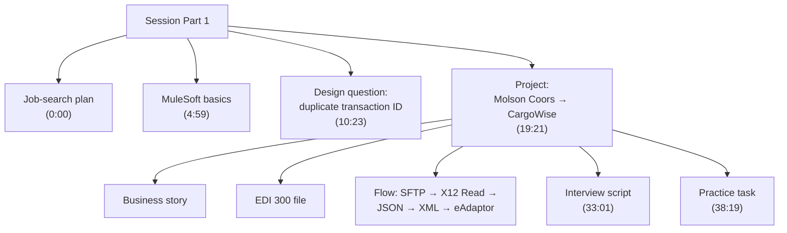

**The one thing to take away:** in an interview, describe *one* project in *one* simple flow, in the first 5–10 minutes, so clearly that the interviewer understands the business. Everything else in this session supports that.

---

## 2. Job-search plan and recruiter calls

### 2.1 Timeline the mentor proposed *(0:00)*

| When | What |
|---|---|
| This week | Make your profile (you offered to start right away) |
| ~1 week after the profile goes up | Expect the first calls |
| 17th–24th | Mentor travelling to Bangalore |
| From the 26th | Résumé preparation together |

### 2.2 What HR asks on the first call *(0:36–2:09)*

Keep **three things** ready:

1. **Roles and responsibilities as a MuleSoft developer.** HR often reads questions from the job description (JD). Answer with points that **match the JD**: API-led connectivity, Choice router, connectors, and so on. Then explain your responsibilities in your own words.
2. **Experience:** total experience, and **relevant MuleSoft experience**.
3. **Money and availability:** **current CTC**, **expected CTC**, **notice period**, and when you are available for interviews.

> *(2:06)* If a company has had an opening for a while, they move fast on a candidate who fits.

🔧 **A ready answer for "What do you do as a MuleSoft developer?"**
> "I design and build integrations in Anypoint Studio, following API-led connectivity. I build flows with connectors such as SFTP, File, HTTP and X12, transform data with DataWeave, use routers like Choice and Scatter-Gather, and implement global error handling and logging. I secure APIs with policies like Client ID Enforcement, keep secrets in secure property files, and deploy to CloudHub 2.0 through CI/CD pipelines."

### 2.3 Track every company *(2:41–4:08)*

You said you'll handle the first calls yourself. The mentor's rule: **note down every company that calls, keep the list, and update each company's status every day.**

🔧 A simple tracker:

| Date | Company / vendor | Role | Round | Status | Next step |
|---|---|---|---|---|---|
| 26-10 | ABC Tech | MuleSoft Dev | HR screen | Shortlisted | L1 on 28-10, 3 pm |

### 2.4 The hiring process *(4:15–4:58)*

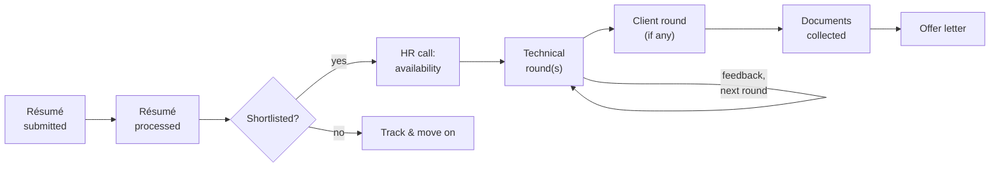

---

## 3. MuleSoft basics the mentor checked

### 3.1 "What styles of architecture are there?" *(5:01)*

You answered **MVC (Model–View–Controller)**: business logic is kept separate from presentation, and **architecture makes debugging easier**. The mentor accepted it as the basic concept, then moved to the real question: *why MuleSoft?*

### 3.2 Why MuleSoft: the database example *(5:37–8:28)*

**Without an integration layer**, every project that touches the company's SQL database must build its own DB connection and its own queries (create, read, update, delete user accounts, and so on). That one database ends up wired into every project.

**With MuleSoft**, one API sits in front of the database. Projects call **endpoints** like `POST /users` to insert or `GET /users` to query, instead of talking to the database directly. The API is built once from a set of requirements and reused everywhere.

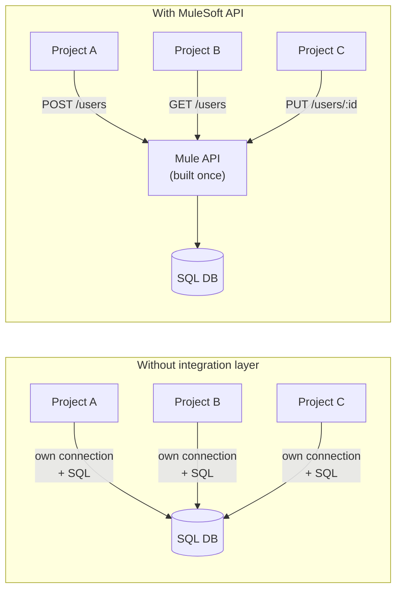

**Interview line:** "MuleSoft is an integration layer. Instead of every system connecting point-to-point, we expose reusable APIs, so a new project only needs the API details, not the database or system internals."

### 3.3 Integration patterns mentioned *(8:31–9:46)*

| Pattern | What it means | Mentioned as |
|---|---|---|
| **API-led connectivity** | APIs in three layers: Experience → Process → System | What the mentor mainly works on |
| **ETL** (Extract, Transform, Load) | Pull data out, reshape it, load it into a target | Another integration pattern |
| **Workflow-based** | One workflow per customer; a new customer gets a new workflow | How the mentor's current company works |
| **Single-layer** | The whole integration in one app | How the sample project is presented |

🔧 **API-led connectivity in one picture**, and where this project would fit if it were split into layers:

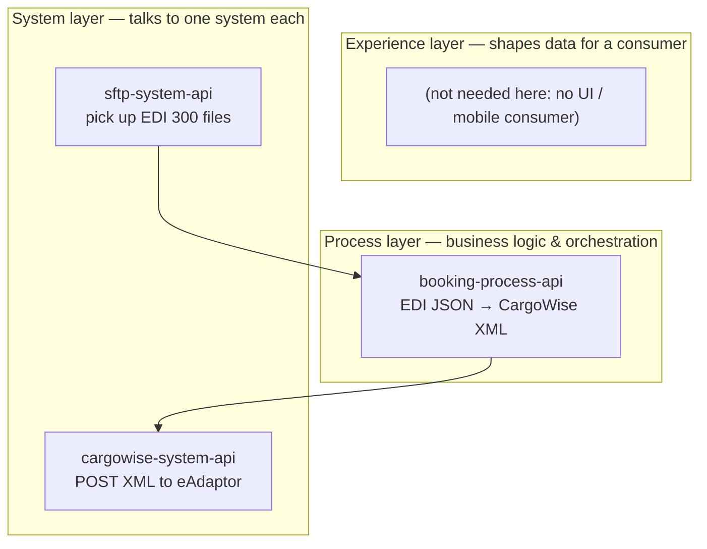

> The mentor deliberately presents the project as **single-layer** *(32:12)*, because that's easier to explain. If an interviewer asks about API-led, you can describe the split above.

---

## 4. Design question: the same transaction ID sent twice

### 4.1 The question *(10:23)*

> A source system sends a **JSON payload with a unique transaction ID**. You **store** it and then **call a target system**. Later, the **same transaction with the same ID** arrives again. What do you do?

This is the classic **idempotency / duplicate check** problem.

### 4.2 Your answer and the mentor's guidance *(12:27–16:15)*

- **You:** a POST API inserts the ID into a DB and calls the target. On the next call, check the DB: if the ID is new, insert; if it exists, **update** (PUT/PATCH) and send to the target.
- **Mentor:** right concept, but answer *in MuleSoft terms*. It doesn't have to be a DB: think **Object Store**, or even a **local file system**.
- **Mentor's file-system version:** store the ID with **Set Variable**, use the File connector's **List** operation to get all file names, **filter** by file name, and **update** if it already exists.

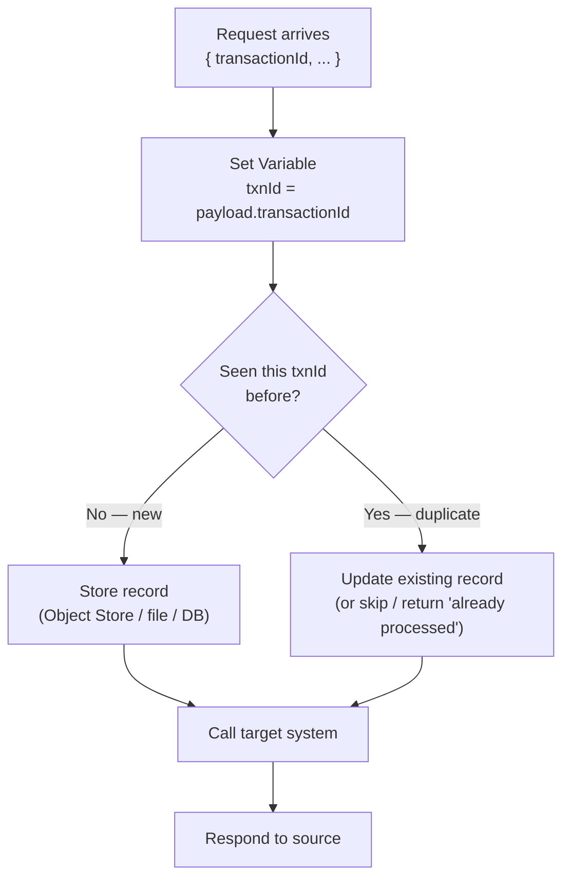

### 4.3 🔧 Three ways to build it in Mule 4

**Option A: the built-in Idempotent Message Validator (the simplest answer to give).**
It checks an ID against an Object Store and throws `MULE:DUPLICATE_MESSAGE` if the ID has been seen before.

```xml
<flow name="txn-flow">
    <http:listener config-ref="HTTP_Listener_config" path="/transactions"/>
    <idempotent-message-validator idExpression="#[payload.transactionId]"
                                  objectStore="txnStore"/>
    <!-- only first-time IDs reach here -->
    <http:request config-ref="Target_Config" method="POST" path="/target"/>
    <error-handler>
        <on-error-continue type="MULE:DUPLICATE_MESSAGE">
            <set-payload value='#[{ status: "duplicate", transactionId: payload.transactionId }]'/>
        </on-error-continue>
    </error-handler>
</flow>
```

**Option B: Object Store `contains` + `store` (when duplicates must update instead of skip).**

```xml
<set-variable variableName="txnId" value="#[payload.transactionId]"/>
<os:contains key="#[vars.txnId]" objectStore="txnStore" target="exists"/>
<choice>
    <when expression="#[vars.exists]">
        <logger level="INFO" message="#['Duplicate ' ++ vars.txnId ++ ' — updating']"/>
    </when>
    <otherwise>
        <logger level="INFO" message="#['New ' ++ vars.txnId]"/>
    </otherwise>
</choice>
<os:store key="#[vars.txnId]" objectStore="txnStore">
    <os:value>#[payload]</os:value>
</os:store>   <!-- store overwrites, so it works as insert OR update -->
<http:request config-ref="Target_Config" method="POST" path="/target"/>
```

**Option C: the local file system (the mentor's version).** Each record is saved as `<transactionId>.json`.

```xml
<set-variable variableName="txnId" value="#[payload.transactionId]"/>
<set-variable variableName="record" value="#[payload]"/>
<file:list config-ref="File_Config" directoryPath="${store.dir}"/>
<set-variable variableName="exists"
    value="#[sizeOf(payload filter ((f) -> f.attributes.fileName == vars.txnId ++ '.json')) > 0]"/>
<file:write config-ref="File_Config" path="#['${store.dir}/' ++ vars.txnId ++ '.json']"
            mode="OVERWRITE">
    <file:content>#[output application/json --- vars.record]</file:content>
</file:write>
```

| | Idempotent Validator | Object Store | File system | Database |
|---|---|---|---|---|
| Effort | Lowest | Low | Medium | Medium |
| Can update a duplicate? | No (rejects it) | Yes | Yes | Yes |
| Survives restarts? | Yes, with a persistent OS | Yes, with a persistent OS | Yes | Yes |
| Shared across workers? | With CloudHub OS v2 | With CloudHub OS v2 | No (local disk) | Yes |

**Interview line:** "I'd use the Idempotent Message Validator backed by a persistent Object Store, keyed on the transaction ID. If the business wants duplicates to update instead of being rejected, I'd use `os:contains` with a Choice router, then `os:store`, which overwrites."

---

## 5. Why you present one simple project

*(16:38–19:40)* The mentor's reasoning:

- Real work is **workflow-based**: one workflow per project.
- If you explain a full ETL architecture, **the interviewer gets confused**, and confusion brings **cross-questions** you can't control.
- So use a **single, simple project** that shows the business clearly.
- This description is **the most important part of the interview**: you'll spend the **first 5–10 minutes** on it. It's the intro that grabs attention, so say it **realistically**. You can use the mentor's words or improve on them.
- *(42:25)* Explain **page one only**. If you say too much, the interviewer won't follow. **Simple and clear.**

---

## 6. The business: Molson Coors and CargoWise

### 6.1 The two systems *(19:56–22:29)*

| | **Molson Coors** | **CargoWise** |
|---|---|---|
| Role | **Source system** | **Target system** |
| What it is | Multinational drink and brewing company, formed by the 2005 merger of Molson (Canada) and Coors (US). HQ Chicago; 5th largest brewer globally *(slide 02)* | **Shipment management tool**: logistics software used by freight forwarders and logistics providers |
| Brands (in case they ask) | Coors Light, Miller Lite, Molson Canadian, Carling, Blue Moon *(slide 02)* | — |
| What it sends or accepts | Sends **EDI 300** booking files | Accepts **XML, in specific modules**, through the **eAdaptor** |

### 6.2 The business problem *(20:52–24:58)*

Molson Coors ships to many countries, so it needs a **logistics partner**, and it wants its bookings to flow into **CargoWise**. Its systems and CargoWise are different, so they hired an integration company that uses MuleSoft. *"That's why we are here."*

**Before (manual):**

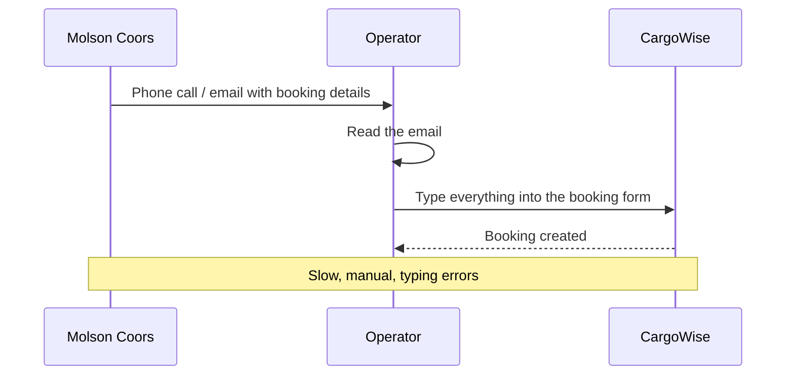

**After (automated with MuleSoft):**

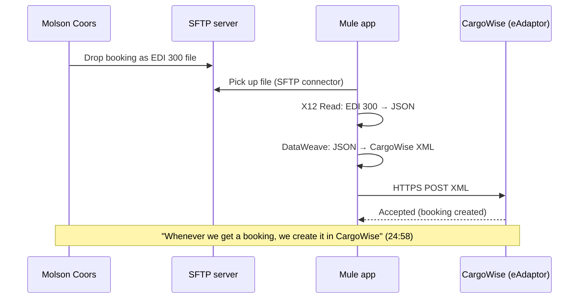

---

## 7. EDI and the EDI 300 file, line by line

### 7.1 What EDI is *(25:04–25:36)*

- **EDI = Electronic Data Interchange.** Companies use it to exchange business documents (orders, invoices, bookings) in a **standard, flat-file, structured format**.
- **ANSI X12** is the North American EDI standard. Each document type has a number: **300** is a booking request.
- **Version:** this project uses **004010** ("4010") *(25:45)*.
- *(26:28)* "All the integration in Molson Coors is based on these files."

### 7.2 How an X12 file is built

🔧 Three layers of envelopes, like letters inside an envelope inside a parcel:

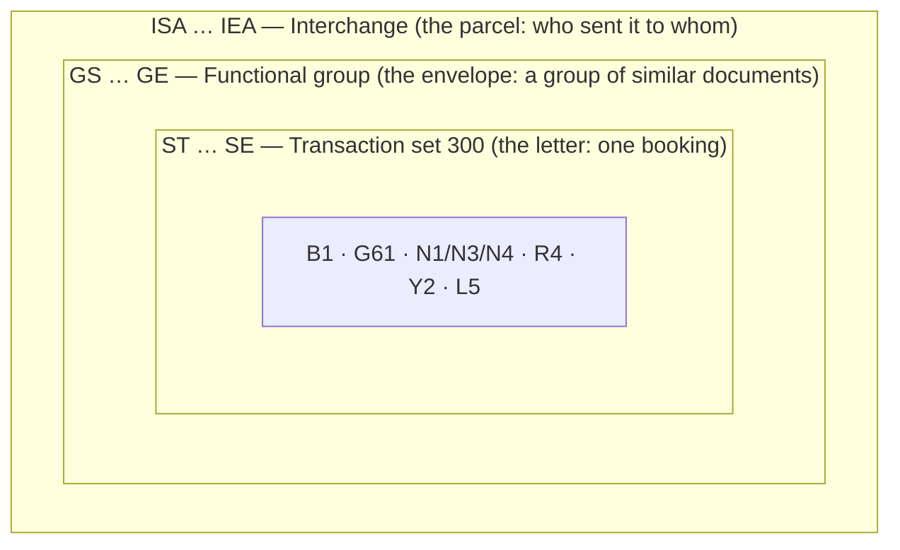

**Delimiters** (the characters that split the file up):

| Character | Meaning | Example |
|---|---|---|
| `~` | Segment terminator (end of line/record) | `ST*300*0001~` |
| `*` | Element separator (between fields) | `B1*OOLU*BKG9876543` |
| `>` | Sub-element separator (last char of ISA) | — |

### 7.3 The sample file from the session

*(26:33, slides 04 and 07)* The `ISA` line was cut off on screen; here it's written out in full, as in [practice/part1/sample-300.edi](../practice/part1/sample-300.edi).

```
ISA*00*          *00*          *ZZ*SHIPPER1       *ZZ*CARRIEROCEAN   *261010*1155*U*00401*000000101*0*T*>~
GS*SO*SHIPPER1*CARRIEROCEAN*20261010*1155*101*X*004010~
ST*300*0001~
B1*OOLU*BKG9876543*20261010*N~
G61*IC*JOHN DOE*TE*5551234567~
N1*SH*GLOBAL SHIPPER INC.*93*12345~
N3*123 LOGISTICS WAY~
N4*SHANGHAI*SH*200000*CN~
N1*CN*WEST COAST DISTRIBUTORS*94*67890~
N3*789 WAREHOUSE BLVD~
N4*LOS ANGELES*CA*90001*US~
R4*L*UN*CNSHA*SHANGHAI~
R4*D*UN*USLAX*LOS ANGELES~
Y2*1*40FT*40G0~
L5*1*ELECTRONIC COMPONENTS*G*8504.40~
SE*14*0001~
GE*1*101~
IEA*1*000000101~
```

> ⚠️ **One fix from the on-screen sample:** the screen showed `SE*13*0001~`, but `SE01` must equal the number of segments from `ST` to `SE` inclusive, and here that's **14**. A wrong count can make X12 Read report a validation error, so the practice file uses `SE*14`.

### 7.4 Every segment explained

| Segment | Name | Fields in this sample | Business meaning *(26:35–27:20)* |
|---|---|---|---|
| `ISA` | Interchange header | `ZZ*SHIPPER1` → `ZZ*CARRIEROCEAN`, date 261010, time 1155, version 00401, control 000000101, `T` = test | Who is sending to whom; the outer envelope |
| `GS` | Functional group header | `SO`, SHIPPER1 → CARRIEROCEAN, 20261010, group control 101, `X` = X12, **`004010`** | Groups transactions; carries the **version** |
| `ST` | Transaction set header | **`300`**, control `0001` | "This is a **booking request**" |
| `B1` | Beginning segment for booking | Carrier `OOLU`, booking no. **`BKG9876543`**, date 20261010, action `N` (new) | **Booking number** |
| `G61` | Contact | `IC` (information contact), **JOHN DOE**, `TE` (telephone) 5551234567 | **Contact information** |
| `N1` | Party name | `SH` = **shipper**: Global Shipper Inc. / `CN` = **consignee**: West Coast Distributors | Who sends, who receives |
| `N3` | Address | 123 Logistics Way / 789 Warehouse Blvd | **Addresses** |
| `N4` | City/state/zip/country | Shanghai, CN / Los Angeles, CA 90001, US | Addresses (cont.) |
| `R4` | Port | `L` = port of **loading**: CNSHA Shanghai / `D` = port of **discharge**: USLAX Los Angeles | **Route details**: where loading and unloading happen |
| `Y2` | Container | 1 × **40FT**, type `40G0` (40 ft general purpose) | "I need a 40-foot general-purpose container" |
| `L5` | Cargo description | **ELECTRONIC COMPONENTS**, `G` = gross weight, **8504.40** | What is being shipped |
| `SE` | Transaction set trailer | 14 segments, control `0001` (matches `ST02`) | End of the booking |
| `GE` | Group trailer | 1 transaction, control 101 (matches `GS06`) | End of the group |
| `IEA` | Interchange trailer | 1 group, control 000000101 (matches `ISA13`) | End of the file |

**Rule to remember:** every header has a matching trailer with the **same control number**: `ST02 = SE02`, `GS06 = GE02`, `ISA13 = IEA02`.

### 7.5 Related transactions *(slide 03; 34:13; 42:02)*

| Code | Name | Direction in this project |
|---|---|---|
| **300** | Reservation (Booking Request), Ocean | Molson Coors → us → CargoWise |
| **301** | Confirmation (Booking), Ocean | CargoWise → us → Molson Coors (*page two*) |
| **303** | Booking cancellation | Shipper → carrier |
| **304** | Shipping instructions (used to make the bill of lading) | Mentioned: "we get 304 like that" |

---

## 8. The integration flow, step by step

### 8.1 The mentor's final screen *(41:20, slide 10)*

```
MOLSON COORS (WHAT IS THIS COMPANY)                                   SOURCE
CARGOWISE (SHIPMENT MANAGEMENT TOOL) accepts xml in specific modules  TARGET

BOOKINGS --> 300 EDI FILE
file connection -->  file pick from sftp
x12 read -->  300 EDI FILE extract to Json
json -- xml transform --> transform to cargowise booking
sending xml to cargowise -> eAdaptor (https) http request
```

### 8.2 The flow as a diagram

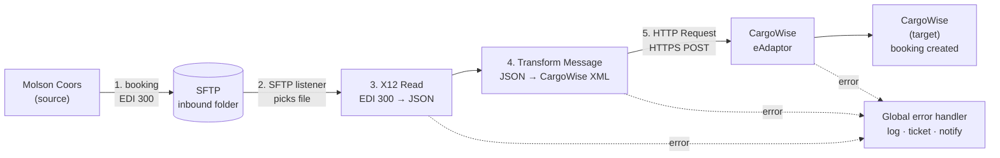

### 8.3 Each step in detail

**Step 1: Bookings arrive as EDI 300 files** *(25:04)*. Molson Coors produces one EDI 300 per booking (or a batch inside one interchange).

**Step 2: Pick up the file over SFTP** *(27:32–28:52)*.
- Files can arrive by **AS2** or **SFTP**.
- **AS2** is a secure B2B protocol over HTTP, where both trading partners exchange **certificates**. It's harder, and it brings many interview questions.
- The mentor's advice: **say SFTP.** "They put the file, and you pick the file up." Most interviewers know SFTP.
- 🔧 In Mule: the **SFTP connector's `On New or Updated File`** listener polls a folder. Set `autoDelete` or `moveToDirectory` so the same file isn't processed twice.

**Step 3: X12 Read converts EDI → JSON** *(28:52–29:58)*.
- "X12 is a connector in MuleSoft." The **X12 Read** operation **parses the file against the X12 schemas defined in the connector** (for example the 004010 / 300 schema) and gives you structured data.
- Then "you can use it as JSON or anything" and **start mapping**.

**Step 4: Transform JSON → CargoWise XML** *(30:08–31:17)*.
- "CargoWise only accepts **XML in specific modules**." So you transform to the exact XML layout that module expects, using DataWeave in a **Transform Message**.
- 🔧 Real CargoWise integrations use CargoWise's own XML formats (the *Universal* XML schemas, e.g. a shipment inside an interchange envelope). The field-level mapping comes from a **mapping sheet**, which the mentor will share for the practice task.

**Step 5: Send to CargoWise via the eAdaptor over HTTPS** *(31:17–31:53)*.
- The **eAdaptor** is CargoWise's integration service ("one of the adapter services"). You **POST the XML over HTTPS** with the **HTTP Request** connector.
- *(32:02)* "This is your complete business, one page of business."

### 8.4 🔧 What the data looks like at each stage

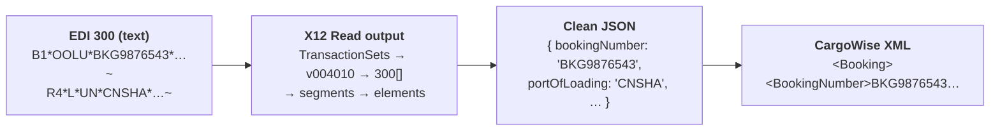

---

## 9. The interview script (memorise this)

*(33:01–37:59)* The mentor's order: **Intro → Experience → Certification → Project → Connections → Security → Error handling → Build & deploy → (questions start).**

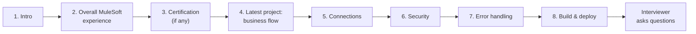

### 9.1 The project (≈ 1.5 minutes)

> "Let me walk you through my latest project. It was the **Molson Coors and CargoWise integration**.
>
> **Molson Coors** was our **source system**. It's a multinational beverages company. **CargoWise** was the **target system**. It's a **shipment management tool** that manages logistics.
>
> Molson Coors ships to many countries, so whenever they have a shipment, they create a **booking**. Earlier, bookings were emailed to operators who typed them into CargoWise manually. We **automated** that.
>
> From Molson Coors we receive the bookings as **EDI 300 files**, version 4010. Similarly we receive other transactions such as the 304. These files contain the **booking information**: booking number, shipper and consignee addresses, contact information, port of loading and port of discharge, container type, and cargo details.
>
> We pick up the files from **SFTP**, and we extract the EDI 300 into **JSON** using the **X12 Read** connector. Then we transform that into **XML** with **DataWeave**, in the format CargoWise expects, because CargoWise accepts XML in specific modules. Finally, we send the XML to CargoWise through its **eAdaptor**, as an **HTTPS** request, and the booking gets created in CargoWise."

### 9.2 Connections *(35:14)*

> "Coming to connections: we receive the files from the client over an **SFTP** connection, and we send them to CargoWise over **HTTPS** using the **eAdaptor**."

### 9.3 Security *(35:44)*

> "We secure our APIs with the **Client ID Enforcement** policy in API Manager, and we secure sensitive values such as passwords in our property files using **Secure Properties** with **AES** encryption."

### 9.4 Error handling *(36:16)*

> "We have **common flows** with a **global error handler**. Whenever there's an issue in any flow, it goes to the global error handler. There we **log the error in a proper format**, store the error message, and **create a ticket** with the **correlation ID**, the error message and the details needed to **retry the same file**. We also **send notifications** to the source and target teams."

### 9.5 Build and deploy *(37:27)*

> "Our code repository was **Bitbucket**. We deploy to **CloudHub 2.0** through **CI/CD with Bitbucket Pipelines**."

### 9.6 Tips for delivering it

- **Page one only.** Don't start with the 301 return flow unless they ask *(42:25)*.
- **Say the business before the tech.** "Bookings were manual; we automated them" makes it real.
- **Use the names**: X12 Read, DataWeave, eAdaptor, Client ID Enforcement, CloudHub 2.0. They signal hands-on work.
- **Practise until it takes about 3 minutes**, without reading.
- After the script, **expect questions** on X12, SFTP, error handling, DataWeave and deployment. See [section 13](#13-interview-questions-and-answers).

---

## 10. Connections, security, error handling, CI/CD

🔧 These sections expand the four short answers in the script so you can survive the follow-up questions.

### 10.1 Connections

| Leg | Protocol | Mule component | Key config |
|---|---|---|---|
| Molson Coors → Mule | **SFTP** | SFTP `On New or Updated File` listener | host, port 22, username, password or key, directory, polling frequency, `moveToDirectory` |
| Mule → CargoWise | **HTTPS** | HTTP Request (eAdaptor URL) | host, port 443, TLS context, path, auth credentials, `Content-Type: application/xml` |
| (Alternative inbound) | **AS2** | AS2 connector | partner IDs, certificates for signing/encryption, MDN receipts |

### 10.2 Security

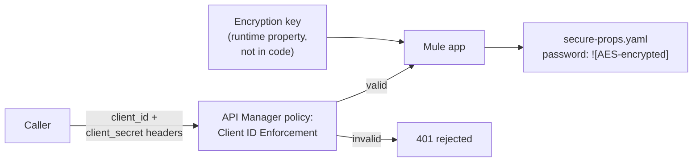

- **Client ID Enforcement:** every caller must send a valid `client_id` and `client_secret` registered in Anypoint Exchange/API Manager.
- **Secure Properties:** passwords are stored encrypted, e.g. `sftp.password: "![x8f…]"`, and read with `${secure::sftp.password}`. The **key** is passed at deploy time, never committed to Git.
- 🔧 Other answers to have ready: TLS/HTTPS on all endpoints, IP allowlisting, rate-limiting policies, OAuth 2.0 for external APIs.

### 10.3 Error handling

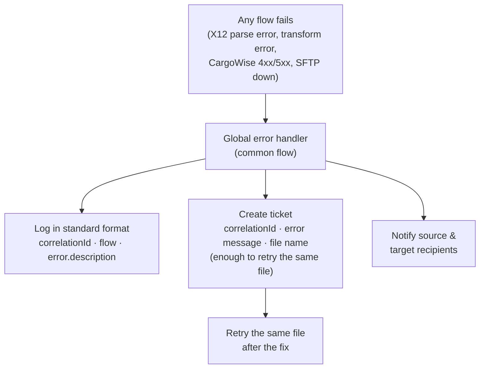

🔧 **In Mule 4:**

```xml
<configuration defaultErrorHandler-ref="global-error-handler"/>

<error-handler name="global-error-handler">
    <on-error-propagate type="X12:PARSE, MULE:EXPRESSION">
        <!-- bad data: log, ticket, notify; do not retry automatically -->
        <flow-ref name="common-log-ticket-notify"/>
    </on-error-propagate>
    <on-error-propagate type="HTTP:CONNECTIVITY, HTTP:SERVICE_UNAVAILABLE">
        <!-- target down: log, ticket; the file can be replayed later -->
        <flow-ref name="common-log-ticket-notify"/>
    </on-error-propagate>
    <on-error-propagate type="ANY">
        <flow-ref name="common-log-ticket-notify"/>
    </on-error-propagate>
</error-handler>
```

- **On Error Propagate:** handles the error, then re-throws it, so the caller or listener sees a failure.
- **On Error Continue:** handles the error and treats the flow as successful.
- **Correlation ID** (`correlationId` in DataWeave): one ID that follows a message through every log line. Put it in the ticket so support can find the exact run.
- 🔧 Exact error type names (e.g. for X12) depend on the connector version; check the error type in the Studio debugger or in your logs.

### 10.4 Build and deploy (CI/CD)

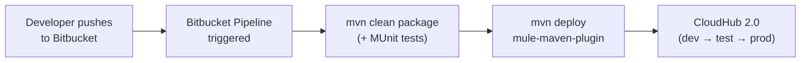

🔧 Points for follow-up questions: the **mule-maven-plugin** does the deployment. Environment-specific values live in property files per environment (`dev.yaml`, `prod.yaml`). Secrets (the secure-properties key, Anypoint credentials) are stored as **pipeline repository variables**, not in code.

---

## 11. The practice task, explained in full

*(38:19–41:13)* This is your homework. Build it, and you can honestly say you've done every step in the script.

### 11.1 What to build

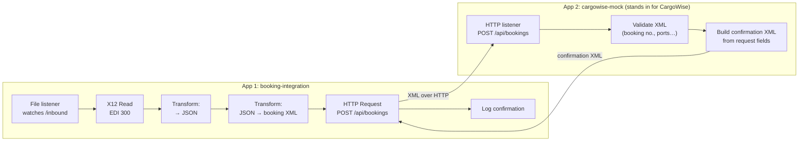

| Mentor's instruction | What it means |
|---|---|
| "Instead of SFTP, just use a **File** connection" | Use the File connector listener on a local folder. Same idea as SFTP, no server needed |
| "Take EDI 300 samples and place them" | Use [practice/part1/sample-300.edi](../practice/part1/sample-300.edi); make copies with different booking numbers |
| "Use the **X12 Read** connector" | Parse the file with the 004010 / 300 schema |
| "Add a **Transform Message** to convert it into JSON" | First DataWeave: X12 structure → clean JSON |
| "I'll give a sample XML / mapping sheet; transform to that XML" | Second DataWeave: JSON → target XML (use the illustrative XML below until you get the real one) |
| "In parallel, create **another API**… it takes an XML payload… respond with a **confirmation message**… put some validations" | App 2: a mock CargoWise that accepts the booking and returns a confirmation built from the request |
| "Deploy this one and keep it" | Run App 2 (locally, or on CloudHub) |
| "After your XML is ready, send the XML" | App 1 calls App 2 with HTTP Request |

### 11.2 Step-by-step build in Anypoint Studio

**Setup**
1. Create folders: `C:\mule\inbound`, `C:\mule\processed`, `C:\mule\error` (or the Linux/Mac equivalents).
2. Create Mule project **`booking-integration`**.
3. From Exchange, add the **X12 connector** and the **File connector** (HTTP is already included).

**App 1, Step 1: the File listener**

```xml
<file:config name="File_Config">
    <file:connection workingDir="C:\mule"/>
</file:config>

<flow name="booking-from-file">
    <file:listener config-ref="File_Config" directory="inbound"
                   moveToDirectory="processed" recursive="false">
        <scheduling-strategy>
            <fixed-frequency frequency="5000"/>
        </scheduling-strategy>
        <file:matcher filenamePattern="*.edi"/>
    </file:listener>
    <logger level="INFO" message="#['Picked up ' ++ attributes.fileName]"/>
    <!-- next steps go here -->
</flow>
```

**App 1, Step 2: X12 Read**

Configure the X12 connector:
- **Schema:** the 004010 300 schema (in the X12 config, add `/x12/004010/300.esl`).
- **Identity:** your side ("self") is the **receiver** in the ISA, `ZZ` / `CARRIEROCEAN`. The partner is the **sender**, `ZZ` / `SHIPPER1`. If these don't match the ISA, the read can be rejected.

```xml
<x12:config name="X12_EDI_Config">
    <x12:schemas>
        <x12:schema value="/x12/004010/300.esl"/>
    </x12:schemas>
</x12:config>

<x12:read config-ref="X12_EDI_Config"/>
```

> 🔧 Option and element names vary slightly between X12 connector versions. Build it in Studio's visual editor first, then look at the XML it generates.

**App 1, Step 3: look at what X12 Read produced (do this first!)**

```xml
<logger level="INFO" message="#[write(payload, 'application/json')]"/>
```

Run it, drop `sample-300.edi` into `inbound`, and read the log. The output is roughly:
`payload.TransactionSets.v004010."300"` → a list of bookings → each booking holds segments → each segment holds elements such as `B102` (the booking number).
**Segment keys carry position prefixes** (for example something like `0200_B1`). Copy the exact keys from your own log; don't guess.

**App 1, Step 4: Transform to clean JSON** (illustrative; it finds segments by name so the position prefixes don't matter)

```dataweave
%dw 2.0
output application/json
// find the first value whose key ends with "_<id>" (e.g. "_B1"), ignoring position prefixes
fun seg(obj, id) = (obj filterObject ((v, k) -> (k as String) endsWith ("_" ++ id)))[0]
var booking = payload.TransactionSets.v004010."300"[0]
var head    = booking.Heading default booking
---
{
  bookingNumber : seg(head, "B1").B102,
  carrier       : seg(head, "B1").B101,
  bookingDate   : seg(head, "B1").B103,
  contact       : { name: seg(head, "G61").G6102, phone: seg(head, "G61").G6104 },
  // Parties, ports, container and cargo sit inside loops; map them the same way
  // once you have seen their exact keys in the log from Step 3.
}
```

The clean JSON you're aiming for:

```json
{
  "bookingNumber": "BKG9876543",
  "carrier": "OOLU",
  "bookingDate": "2026-10-10",
  "contact": { "name": "JOHN DOE", "phone": "5551234567" },
  "shipper":   { "name": "GLOBAL SHIPPER INC.", "address": "123 LOGISTICS WAY", "city": "SHANGHAI", "country": "CN" },
  "consignee": { "name": "WEST COAST DISTRIBUTORS", "address": "789 WAREHOUSE BLVD", "city": "LOS ANGELES", "state": "CA", "zip": "90001", "country": "US" },
  "portOfLoading":   { "code": "CNSHA", "name": "SHANGHAI" },
  "portOfDischarge": { "code": "USLAX", "name": "LOS ANGELES" },
  "container": { "count": 1, "type": "40G0", "size": "40FT" },
  "cargo": { "description": "ELECTRONIC COMPONENTS", "grossWeight": 8504.40 }
}
```

**App 1, Step 5: Transform JSON → booking XML**

> This XML is **illustrative**, so you can practise now. Replace it with the mentor's sample XML / mapping sheet when you get it.

```dataweave
%dw 2.0
output application/xml
---
BookingRequest: {
  BookingNumber: payload.bookingNumber,
  Carrier:       payload.carrier,
  BookingDate:   payload.bookingDate,
  Contact: { Name: payload.contact.name, Phone: payload.contact.phone },
  Shipper:   { Name: payload.shipper.name,   City: payload.shipper.city,   Country: payload.shipper.country },
  Consignee: { Name: payload.consignee.name, City: payload.consignee.city, Country: payload.consignee.country },
  PortOfLoading:   payload.portOfLoading.code,
  PortOfDischarge: payload.portOfDischarge.code,
  Container: { Count: payload.container.count, Type: payload.container.type },
  Cargo: { Description: payload.cargo.description, GrossWeight: payload.cargo.grossWeight }
}
```

**App 1, Step 6: send to App 2**

```xml
<http:request-config name="CargoWise_Mock_Config">
    <http:request-connection host="localhost" port="8082"/>
</http:request-config>

<http:request config-ref="CargoWise_Mock_Config" method="POST" path="/api/bookings">
    <http:headers>#[{ "Content-Type": "application/xml" }]</http:headers>
</http:request>
<logger level="INFO" message="#['CargoWise response: ' ++ write(payload, 'application/xml')]"/>
```

**App 2: `cargowise-mock` (the "second API")**

Create a second Mule project. Its HTTP listener runs on **port 8082** so it doesn't clash with App 1.

```xml
<http:listener-config name="Mock_Listener">
    <http:listener-connection host="0.0.0.0" port="8082"/>
</http:listener-config>

<flow name="receive-booking">
    <http:listener config-ref="Mock_Listener" path="/api/bookings">
        <!-- lets the error handler choose the status code (400 for bad bookings) -->
        <http:error-response statusCode="#[vars.httpStatus default 500]">
            <http:body>#[payload]</http:body>
        </http:error-response>
    </http:listener>
    <!-- validations: reject if key fields are missing -->
    <validation:is-not-blank-string value="#[payload.BookingRequest.BookingNumber]"
        message="BookingNumber is required"/>
    <validation:is-not-blank-string value="#[payload.BookingRequest.PortOfLoading]"
        message="PortOfLoading is required"/>
    <ee:transform>
        <ee:message>
            <ee:set-payload><![CDATA[%dw 2.0
output application/xml
var b = payload.BookingRequest
---
BookingConfirmation: {
  BookingNumber:   b.BookingNumber,
  Status:          "ACCEPTED",
  ConfirmationRef: "CW-" ++ b.BookingNumber,
  PortOfLoading:   b.PortOfLoading,
  PortOfDischarge: b.PortOfDischarge,
  ReceivedAt:      now() as String { format: "yyyy-MM-dd'T'HH:mm:ss" }
}]]></ee:set-payload>
        </ee:message>
    </ee:transform>
    <error-handler>
        <on-error-propagate type="VALIDATION:BLANK_STRING">
            <set-variable variableName="httpStatus" value="400"/>
            <set-payload value='#[output application/xml --- { BookingError: { Message: error.description } }]'/>
        </on-error-propagate>
    </error-handler>
</flow>
```

(Add the **Validation** module from Exchange for `validation:*`.)

This is "not completely dummy" *(39:53)*: the confirmation reuses fields from the booking it received, and it **rejects** bookings that are missing key fields.

### 11.3 How to test

| # | Test | Expected result |
|---|---|---|
| 1 | Start App 2, then App 1. Drop `sample-300.edi` into `inbound` | Log shows "Picked up…", the clean JSON, and a `BookingConfirmation` with `Status ACCEPTED`; the file moves to `processed` |
| 2 | Copy the file, change `BKG9876543` to `BKG0000001` | A new confirmation with the new booking number |
| 3 | Break the file: delete the `SE` line | X12 Read raises an error; your error handler logs it |
| 4 | Remove the booking number from the XML (edit the DataWeave temporarily) | App 2 returns 400 with `BookingError` |
| 5 | Stop App 2 and drop a file | `HTTP:CONNECTIVITY` error, handled and logged |
| 6 | Test App 2 alone in Postman: POST XML to `http://localhost:8082/api/bookings` | Confirmation XML comes back |

### 11.4 Levelling up *(40:46)*

The mentor's order for later:

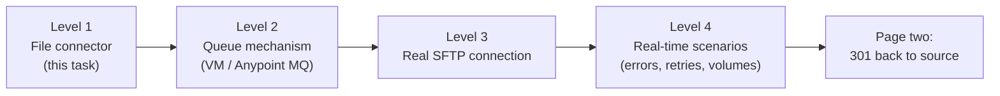

🔧 What each level adds:
- **Queue:** the listener only publishes the file to a queue; a separate flow consumes and processes it. If CargoWise is down, messages wait in the queue instead of failing.
- **SFTP:** swap `file:listener` for `sftp:listener`, keep the rest. Practise with a local SFTP server (e.g. a Docker SFTP image).
- **Real-time:** add the global error handler, a correlation ID in every log, retries with **Until Successful** on the HTTP call, and handling of several bookings in one file.

### 11.5 Common problems

| Symptom | Likely cause | Fix |
|---|---|---|
| X12 Read error about identity or partner | ISA sender/receiver doesn't match the X12 config's self/partner IDs | Self = `ZZ/CARRIEROCEAN`, Partner = `ZZ/SHIPPER1` (or relax the identity check) |
| X12 Read error about segment count | `SE01` doesn't match the real count | Count `ST` to `SE` inclusive (14 in the sample) |
| ISA errors | The ISA segment must be fixed width (106 chars including `~`) | Keep the padding spaces exactly as in the sample |
| Same file processed repeatedly | No `moveToDirectory` / `autoDelete` | Set `moveToDirectory="processed"` |
| DataWeave returns `null` | Wrong segment keys | Log the X12 output (Step 3) and copy the real keys |
| App 2 port already in use | Both apps on 8081 | Run App 2 on 8082 |

---

## 12. Page two: sending the 301 confirmation back

*(41:16–42:13)* After the booking is created, the business is **two-way**:

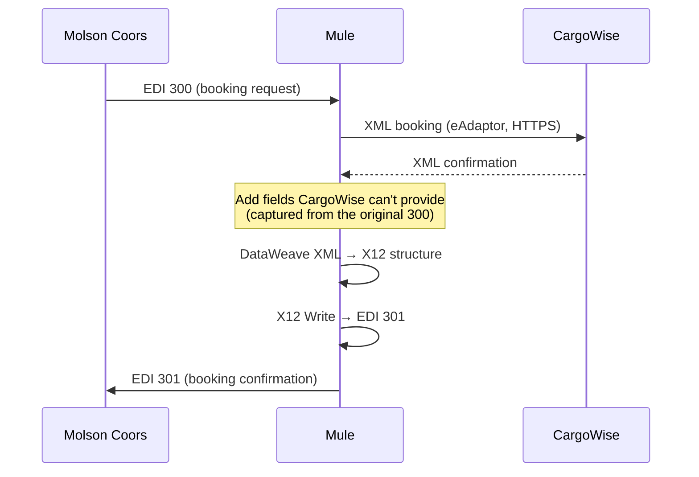

Key points from the mentor:
- The source wants the answer **in EDI format only**: a **300** request gets a **301** confirmation.
- CargoWise **can't send some fields** that Molson Coors needs, so you **capture them from the original 300** and **inject** them into the 301.
- You build the EDI file with the **X12 Write** operation. "That mapping will be hard."
- **Don't lead with this in interviews.** Mention it only if they ask about the return flow.

🔧 To capture fields for later, store them when the 300 arrives, keyed by booking number (Object Store, as in [section 4](#4-design-question-the-same-transaction-id-sent-twice)), and read them back when the confirmation comes.

---

## 13. Interview questions and answers

### Project questions

**Q1. Explain your project.**
Use the script in [section 9.1](#91-the-project--15-minutes). Business first, then the flow: SFTP → X12 Read → JSON → DataWeave XML → eAdaptor over HTTPS.

**Q2. What is EDI? What is X12?**
EDI is electronic data interchange: a standard way for companies to exchange business documents as structured flat files. X12 is the ANSI standard used mainly in North America; each document has a number, like 300 for a booking request or 850 for a purchase order.

**Q3. What does an EDI 300 contain?**
The booking: `B1` booking number and carrier, `G61` contact, `N1/N3/N4` shipper and consignee names and addresses, `R4` ports of loading and discharge, `Y2` container requirement, `L5` cargo description and weight, all inside the `ST/SE`, `GS/GE` and `ISA/IEA` envelopes.

**Q4. Which X12 version did you use?**
004010 (4010).

**Q5. Explain ISA, GS and ST.**
`ISA/IEA` is the interchange envelope (sender, receiver, control number). `GS/GE` is the functional group (groups transactions of one type; carries the version). `ST/SE` is one transaction, for example one booking. Each header's control number must match its trailer.

**Q6. How do you convert EDI to JSON in MuleSoft?**
With the X12 connector's **Read** operation, configured with the 004010 300 schema. It parses the file into a structured object, and then DataWeave maps it to JSON.

**Q7. Why convert to JSON first and not straight to XML?**
JSON is a clean, canonical model of the booking. It's easy to log, validate and reuse, and if a second target is added later, you map from the same JSON. (You *can* map straight from the X12 output to XML; the two-step approach is the mentor's flow.)

**Q8. What does CargoWise accept?**
XML in specific module formats, received through its **eAdaptor** over HTTPS.

**Q9. Why SFTP and not AS2?**
SFTP is what the client used for this integration: they drop files, and we pick them up. AS2 is a B2B protocol over HTTP that uses certificates for signing and encryption, plus receipts (MDNs). It's common in EDI, but we didn't need it here.

**Q10. How do you avoid processing the same file twice?**
The SFTP/File listener moves or deletes each file after pick-up (`moveToDirectory` / `autoDelete`). For extra safety, an idempotency check on the booking number (Idempotent Message Validator with an Object Store).

**Q11. What happens if CargoWise is down?**
The HTTP Request fails with a connectivity error, and the global error handler logs it, creates a ticket with the correlation ID and file name, and notifies. The file can be replayed. Better still: retry with **Until Successful**, or put a queue in between.

**Q12. What if the EDI file is invalid?**
X12 Read raises a parse/validation error, and the global error handler logs it and notifies the source so they can resend a corrected file. Bad data isn't retried automatically.

**Q13. How do you send a confirmation back?**
CargoWise's XML confirmation is mapped back to an X12 structure, extra fields captured from the original 300 are added, and **X12 Write** generates an **EDI 301**, which is sent back to Molson Coors.

### MuleSoft concept questions

**Q14. Why MuleSoft?**
It's an integration layer: reusable APIs instead of point-to-point connections. New projects call existing endpoints instead of re-implementing database or system access *(5:37)*.

**Q15. What is API-led connectivity?**
Three layers of APIs: **System** APIs unlock one system each, **Process** APIs hold business logic and orchestration, **Experience** APIs shape data for each consumer. Each layer is reusable.

**Q16. Same transaction ID sent twice: what do you do?**
Use the **Idempotent Message Validator** with a persistent Object Store keyed on the transaction ID. If duplicates must update rather than be rejected: `os:contains` plus a Choice router, then `os:store` *(section 4)*.

**Q17. Set Variable vs Set Payload?**
Set Payload replaces the message body. Set Variable stores a value under a name (`vars.name`) that stays available through the rest of the flow, without touching the payload.

**Q18. On Error Propagate vs On Error Continue?**
Propagate handles the error and re-throws it, so the caller sees a failure. Continue handles it and lets the flow finish as a success, using the error handler's result as the response.

**Q19. How do you secure your APIs?**
**Client ID Enforcement** in API Manager, HTTPS/TLS, and **Secure Properties** with AES encryption for credentials, with the key supplied at deploy time.

**Q20. What is a correlation ID?**
A unique ID for one message's journey. It's included in every log line and ticket, so you can trace one booking end to end.

**Q21. How do you deploy?**
Code in **Bitbucket**, with **Bitbucket Pipelines** running Maven builds (plus MUnit tests) and deploying with the mule-maven-plugin to **CloudHub 2.0**, per environment.

**Q22. File List vs File Read?**
**List** returns the files in a directory (with attributes like `fileName`). **Read** returns the content of one file at a given path. In the duplicate-check design, List checks whether `<id>.json` exists.

**Q23. What is Object Store?**
A key–value store built into Mule for small state: idempotency keys, watermarks, cached tokens. A persistent Object Store survives restarts; on CloudHub, Object Store v2 is shared across workers.

---

## 14. Glossary

| Term | Meaning |
|---|---|
| **AS2** | Applicability Statement 2: a secure B2B protocol over HTTP using certificates and receipts (MDNs) |
| **CargoWise** | Logistics / shipment management software; the target system |
| **eAdaptor** | CargoWise's integration service, which accepts XML over HTTPS |
| **Consignee** | The party receiving the goods (`N1*CN`) |
| **Shipper** | The party sending the goods (`N1*SH`) |
| **Port of loading / discharge** | Where the container is loaded (`R4*L`) / unloaded (`R4*D`) |
| **40G0** | Container type code: 40 ft general purpose |
| **EDI 300 / 301 / 303 / 304** | Booking request / booking confirmation / cancellation / shipping instructions |
| **X12 Read / Write** | MuleSoft X12 connector operations: parse EDI → data / generate data → EDI |
| **DataWeave** | MuleSoft's transformation language (Transform Message) |
| **Object Store** | Mule's built-in key–value store |
| **Client ID Enforcement** | API Manager policy requiring a valid client_id and client_secret |
| **Secure Properties** | Encrypted property values, e.g. with AES |
| **CloudHub 2.0** | MuleSoft's managed cloud runtime |
| **CTC** | Cost to company: total annual salary package |
| **JD** | Job description |

---

## 15. One-page revision sheet

**Business:** Molson Coors (beverage company, **source**) books shipments in **CargoWise** (shipment management tool, **target**). Bookings used to be manual (email → operator → form); we **automated** them with MuleSoft.

**Flow:**
`EDI 300 on SFTP` → **SFTP listener** → **X12 Read** (004010/300) → **JSON** → **DataWeave** → **CargoWise XML** → **HTTP Request (HTTPS)** → **eAdaptor** → booking created.

**EDI 300:** `B1` booking no. · `G61` contact · `N1/N3/N4` shipper (SH) and consignee (CN) · `R4` ports (L loading, D discharge) · `Y2` container · `L5` cargo · envelopes `ISA/GS/ST … SE/GE/IEA` with matching control numbers.

**Script order:** Intro → Experience → Certification → **Project** → Connections (SFTP in, HTTPS/eAdaptor out) → Security (Client ID Enforcement, AES Secure Properties) → Errors (global handler: log, ticket with correlation ID, retry, notify) → Deploy (Bitbucket → Pipelines → CloudHub 2.0).

**Duplicate ID answer:** Idempotent Message Validator plus a persistent Object Store; to update duplicates, `os:contains` → Choice → `os:store`.

**Practice task:** File listener → X12 Read → JSON → XML → POST to **your own mock CargoWise API** (validates, returns a confirmation built from the request). Then: queue → real SFTP → real-time handling → **301 back with X12 Write**.

**Golden rule:** *page one only, simple and clear.*
