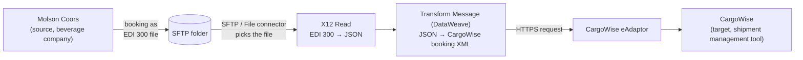

# Project Session Part 1 — Slides and On-Screen Notes

Screens from the Part 1 mentoring session. The first ~19 minutes are a webcam conversation (job-search process, MuleSoft architecture, an idempotency design question), so no slides come from that part. From 19:21 the mentor shares their screen and builds the **Molson Coors → CargoWise booking integration** explanation in Notepad++, next to a sample EDI 300 file. Frames are cropped to the shared window. Times are positions in the video.

Transcript: [cleaned](../../transcripts/part1.md) · [raw Whisper output](../../transcripts/part1-raw.txt)

| # | Time | Content |
|---|---|---|
| 01 | 22:20 | First line of the project notes: `MOLSON COORS (WHAT IS THIS COMPANY)` (the source system) |
| 02 | 25:42 | Google overview of Molson Coors Beverage Company (multinational drink and brewing company formed by the 2005 merger of Molson and Coors; HQ Chicago; 5th largest brewer) |
| 03 | 26:08 | Google result: key segments in an EDI 300 file (ISA/GS/ST, B1, G61, N1–N4, R4, Y2, L5, SE) and related ocean transactions 301, 303, 304 |
| 04 | 26:33 | Sample EDI 300, second half: parties, ports, container, cargo, trailers (`SE`, `GE`, `IEA`) |
| 05 | 27:32 | Notes so far: source `MOLSON COORS`, target `CARGOWISE (SHIPMENT MANAGEMENT TOOL)`, `BOOKINGS --> 300 EDI FILE`, with the sample file pasted below |
| 06 | 29:39 | Steps added: `sftp connection --> file pick from sftp`, `x12 read --> 300 EDI FILE extract` |
| 07 | 29:42 | Sample EDI 300, body: `B1` booking, `G61` contact, `N1/N3/N4` shipper and consignee, `R4` ports, `Y2` container, `L5` cargo |
| 08 | 31:26 | Steps added: `extract to Json`, `json -- xml transform --> transform to cargowise booking`, `sending xml to cargowise` (CargoWise accepts XML in specific modules) |
| 09 | 39:03 | Practice-task version: `sftp connection` changed to `file connection --> file pick` |
| 10 | 41:20 | Final flow: `sending xml to cargowise -> eAdaptor (https) http request` |

## The flow on the final screen (slide 10)

```
MOLSON COORS (WHAT IS THIS COMPANY)                 SOURCE
CARGOWISE (SHIPMENT MANAGEMENT TOOL) accepts xml in specific modules   TARGET

BOOKINGS --> 300 EDI FILE
file connection -->  file pick from sftp
x12 read -->  300 EDI FILE extract to Json
json -- xml transform --> transform to cargowise booking
sending xml to cargowise -> eAdaptor (https) http request
```



## The sample EDI 300 file (slides 04, 05, 07)

Typed from the screen. The `ISA` line runs off the right edge of the editor, so only its start is visible.

```
ISA*00*          *00*          *ZZ*SHIPPER1       *ZZ*CAR…   (cut off on screen)
GS*SO*SHIPPER1*CARRIEROCEAN*20261010*1155*101*X*004010~
ST*300*0001~
B1*OOLU*BKG9876543*20261010*N~
G61*IC*JOHN DOE*TE*5551234567~
N1*SH*GLOBAL SHIPPER INC.*93*12345~
N3*123 LOGISTICS WAY~
N4*SHANGHAI*SH*200000*CN~
N1*CN*WEST COAST DISTRIBUTORS*94*67890~
N3*789 WAREHOUSE BLVD~
N4*LOS ANGELES*CA*90001*US~
R4*L*UN*CNSHA*SHANGHAI~
R4*D*UN*USLAX*LOS ANGELES~
Y2*1*40FT*40G0~
L5*1*ELECTRONIC COMPONENTS*G*8504.40~
SE*13*0001~
GE*1*101~
IEA*1*000000101~
```

What each line means, as explained in the session (26:35–27:20) and on slide 03:

| Segment | Meaning | In this sample |
|---|---|---|
| `ISA` / `IEA` | Interchange envelope (start / end) | Sender `SHIPPER1`; control number `000000101` |
| `GS` / `GE` | Functional group (start / end); `004010` is the X12 version used | `SO` group, `SHIPPER1` → `CARRIEROCEAN` |
| `ST` / `SE` | Transaction set (start / end); `300` = Reservation (Booking Request, Ocean) | 13 segments, control `0001` |
| `B1` | Beginning segment for booking: carrier, booking number, date, action (`N` = new) | `OOLU`, `BKG9876543`, 2026-10-10 |
| `G61` | Contact person | John Doe, phone 5551234567 |
| `N1` / `N3` / `N4` | Party name / address / city-state-zip-country (`SH` = shipper, `CN` = consignee) | Global Shipper Inc., Shanghai → West Coast Distributors, Los Angeles |
| `R4` | Port: `L` = port of loading, `D` = port of discharge | CNSHA Shanghai → USLAX Los Angeles |
| `Y2` | Container requirement | 1 × 40 ft, type `40G0` (40 ft general purpose) |
| `L5` | Cargo description | Electronic components, gross weight 8504.40 |
